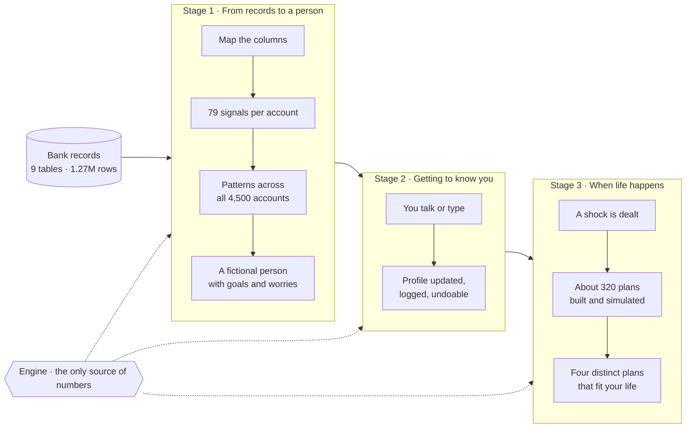
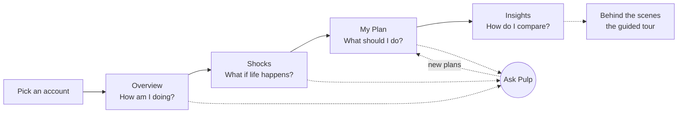
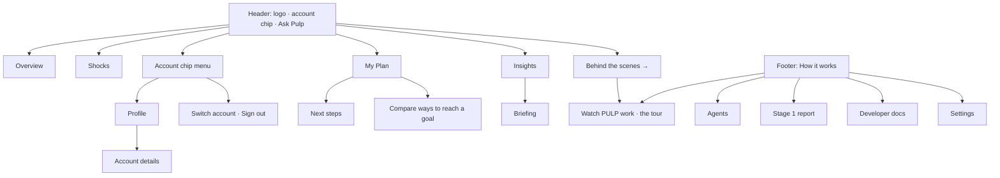
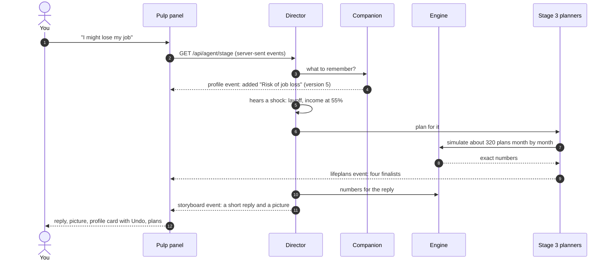
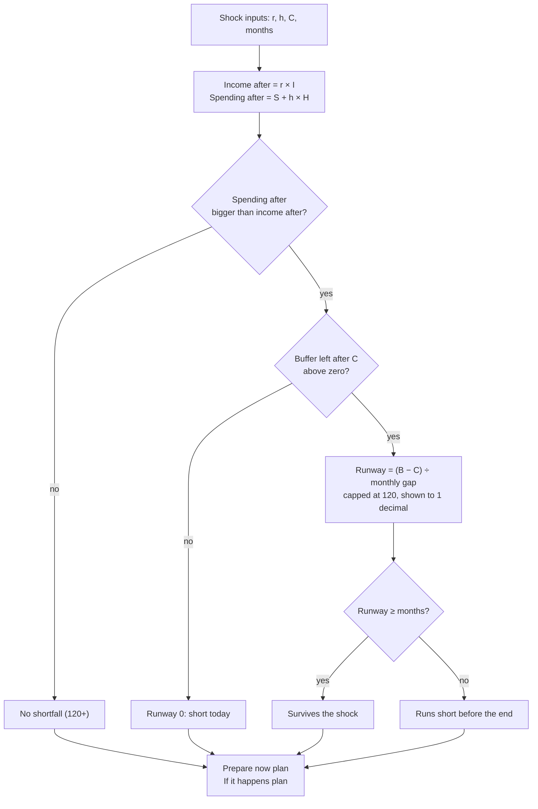
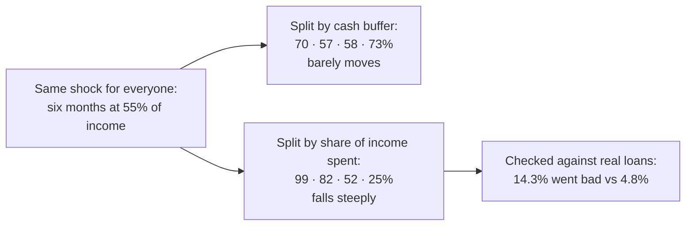
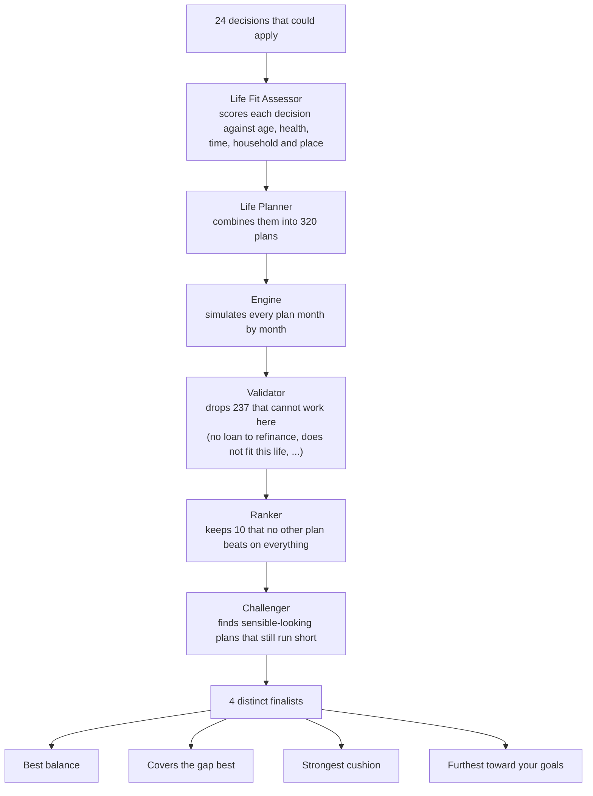
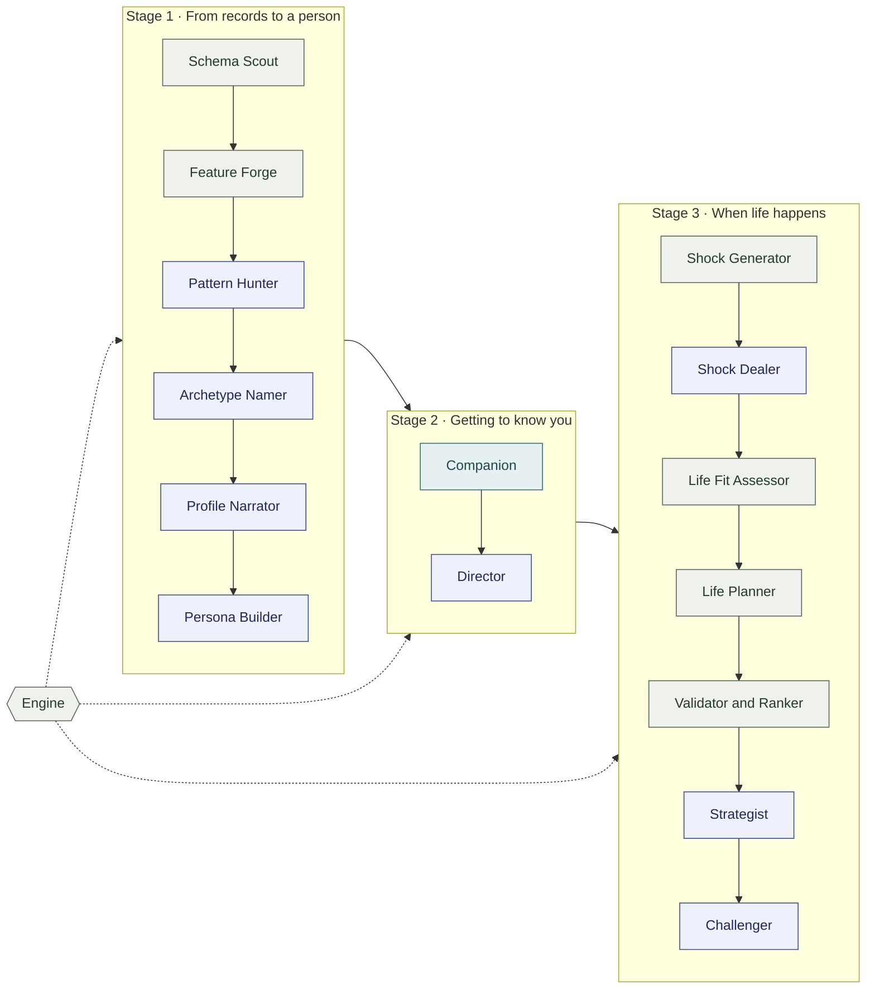
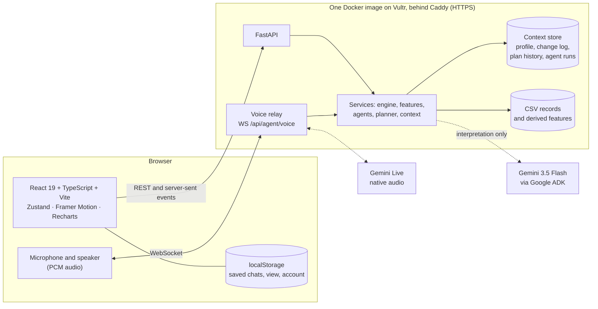
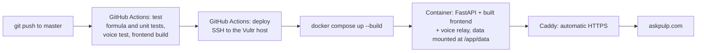

# PULP

**Planning Under Life’s Pressures.** Prepare for what comes next.

PULP reads a bank account’s records, tests what life’s shocks would do to it, and hands back a plan you could actually
follow. It was built for the Tangerine track (“Resilience Rewired”) at the Sheridan Datathon 2026, on the supplied
anonymized bank data. Pulp, a tangerine companion, talks it through with you by text or by voice.

**Live:** [askpulp.com](https://askpulp.com) · **Guided tour of the agents:** [askpulp.com/tour](https://askpulp.com/tour) ·
**API docs in the app:** [askpulp.com/developers](https://askpulp.com/developers)

> **The one rule:** agents interpret, code calculates. No AI model ever produces a number that you see. Every figure
> comes from a tested Python engine that uses the judges’ exact definitions; the agents decide what to look at, what to
> ask and how to say it.

---

## Contents

1. [PULP in one minute](#pulp-in-one-minute)
2. [Try it in two minutes](#try-it-in-two-minutes)
3. [The site, page by page](#the-site-page-by-page)
4. [Pulp, the companion](#pulp-the-companion)
5. [How the numbers work](#how-the-numbers-work)
6. [What we found](#what-we-found)
7. [How the plans are chosen](#how-the-plans-are-chosen)
8. [The agents](#the-agents)
9. [How it is built](#how-it-is-built)
10. [Run it locally](#run-it-locally)
11. [Tests](#tests)
12. [Deployment](#deployment)
13. [Limits and privacy](#limits-and-privacy)
14. [More documentation](#more-documentation)
15. [Team, credits and sources](#team)

---

## PULP in one minute

Pick any of the 4,500 accounts. PULP answers four questions, one per tab:

| Tab | Question | Example answer (account 74916) |
|---|---|---|
| **Overview** | How am I doing? | “You keep about $247 in a typical month, and your $16,682 cushion would cover about 1.4 months of spending.” |
| **Shocks** | What if life happens? | “If income drops to 55%, your cash would run out after about 3.1 months, and you would be about $15,334 short by month 6.” |
| **My Plan** | What should I do? | “Start with a weekend job for a year and two more steps below; with them, no month runs short and you would have $18,221 by month 18.” |
| **Insights** | How do I compare? | “Your cash cushion is smaller than 66% of accounts, and you spend a bigger share of what comes in than 68% of them.” |

Behind those answers, sixteen agents work in three stages:



---

## Try it in two minutes

1. Open [askpulp.com](https://askpulp.com) and pick a sample account, or type an ID (for example **74916**) into the
   account chip at the top right.
2. **Overview** answers “How am I doing?” in one sentence, then shows the typical month and Pulp’s biggest discovery.
3. **Shocks**: turn over a card (laid off, the furnace dies, layoff and bills) or type your own numbers. See when the
   cushion runs out, month by month.
4. **My Plan**: the four plans the agents kept, each step dated and explained.
5. Press **Ask Pulp** (bottom right) and say something like “I might lose my job” or “a hospital bill of 4,000”. The
   profile updates and new plans arrive in the chat.
6. Click **Behind the scenes →** (right end of the tab bar) for a guided, skippable tour of everything the agents did
   for this account.



---

## The site, page by page



Every page has a **Simple** view (the default: the answer and the essentials) and a **Full detail** view (everything),
switched at the top right. **Explain this** buttons give the plain version of any section with your own numbers.

### The four tabs (for the customer)

| Tab | What is on it |
|---|---|
| **Overview** | The one-sentence answer. The typical month (money in, money out, what is left, the cash cushion, baseline runway) with a picture of the month and what-if sliders. Pulp’s **biggest discovery** about you: the one finding most worth knowing, ranked by how serious it is, how rare it is across all 4,500 accounts and how unlikely you are to notice it yourself, with the evidence and one thing to do. |
| **Shocks** | Four face-down twist cards: the brief’s three official cards and a fourth dealt from a deck made for this life. Each reveal names who brings the shock and why. Or type your own: income retained, household bills change, a one-time cost and the duration. You get the verdict, the cushion month by month, cash over time, and both official plans (**Prepare now** and **If it happens**). |
| **My Plan** | Opens with the plans. **If a shock hits**: four distinct finalists (best balance, covers the gap best, strongest cushion, furthest toward your goals), each step dated with the reason it is there and what it moves; plans that look sensible but still run short, for contrast; how your plans changed over time. **Long term**: a multi-year plan with no shock. Links to Next steps and to comparing ways to reach a goal. |
| **Insights** | How this account compares: its patterns, what your age, household and district say, the dataset-wide findings, and the check against real loan outcomes. Every chart has a juice-cup view with the same numbers, tagged **Recorded** (what happened in the bank’s records) or **Simulated** (the engine’s test). |

### Reached from inside a tab or the header

| Page | Where from | What is on it |
|---|---|---|
| **Profile** | Account chip menu | The person behind the account: a fictional persona, goals weighted by importance and time horizon, goal ideas you can re-rank by angle, worries and questions, how you compare, and the **History** of every change, each one undoable. |
| **Account details** | Profile | What you own and owe (update balances yourself), goal savings, where money goes, and the details you told Pulp. |
| **Next steps** | My Plan | What you could do this week, this month and this year. |
| **Compare ways to reach a goal** | My Plan | Strategies for one goal against your timeline and budget. |
| **Briefing** | Insights | A saved daily or weekly financial picture. |

### Behind the scenes (for judges and developers)

| Page | What is on it |
|---|---|
| **Watch PULP work** (`/tour`) | A guided, skippable tour of what every agent did for the loaded account, in three chapters: *From records to you*, *How talking updates you*, *When life happens*. Simple view tells each step as a picture (juice cups, the plan “press”, a card shuffle, a flipping profile card); Full detail shows what went into each agent and what came out. Back and Next, arrow keys, Skip chapter, Skip to the end, Autoplay, and `?chapter=1`, `2` or `3` to start at a chapter. |
| **Agents** (`/agents`) | The three stages as cards, the full relay of each stage, the plan search, and every recorded agent run, replayable step by step with its raw log. |
| **Stage 1 report** (`/report`) | Everything Stage 1 learned, in plain language and in technical detail; downloadable or printable. |
| **Developer docs** (`/developers`) | Every API endpoint with examples, a flowchart of the agents, the stack and the infrastructure. |
| **Settings** | Replay the opening animation and see where the data comes from. |

---

## Pulp, the companion

Pulp sits at the bottom right of every page (on phones, in the header). Open it to:

- **Type or talk.** The mic starts a live voice conversation (Gemini Live native audio) that shares the same thread,
  memory and visuals as typing.
- **Mention a shock or a decision** in plain words (“I might lose my job”, “rent is going up 10%”, “should I take a
  second job?”, “what if a recession hits”). The Stage 3 agents plan for it straight away and the plans appear in the
  chat.
- **Watch your profile change.** Pulp says what it changed (“Added concern: risk of job loss”). Say “no” to undo it,
  or undo any change from the card in the chat or the Profile History.
- **Turn on Agents** to see the workflow beside the chat: which agent ran, what it was given and what it handed on.
- **Keep your chats.** Each visit starts a fresh chat; a chat used in the last three hours is picked up again. Earlier
  chats are under **Your chats** (history icon) and **New chat** (pencil) starts another. Up to 20 chats per account are
  kept in your browser and cleared on sign-out. Pulp’s memory of your profile is kept on the server, so a new chat still
  knows your goals and worries.

### What happens in one turn



Voice uses the same pipeline: the browser streams audio to `WS /api/agent/voice/{account_id}`, the server relays it to
Gemini Live, and when Gemini needs PULP it calls the same turn function, so voice and text never disagree.

---

## How the numbers work

The official numbers come from `monthly_summary.csv` and `loans.csv` with the judges’ definitions. They never wait on a
model and run with no AI key at all.

| Symbol | Meaning | Definition |
|---|---|---|
| **I** | Typical money in | Median of `money_in` |
| **S** | Typical spending | Median of `money_out` |
| **F** | Fixed costs | Median of `household_bills + insurance + loan_payments` (shown, not added again) |
| **H** | Household bills | Median of `household_bills` |
| **B** | Cash buffer | Mean of `avg_daily_balance` over the account’s last six months |
| **P** | Loan payment | `monthly_payment` if the loan is still running at the end of 2025 |

A shock has four inputs: income retained **r**, household bills change **h**, a one-time cost **C**, and a duration in
months.

$$\text{runway} = \frac{B - C}{(S + hH) - rI}$$



- **Prepare now**: the cash target for the whole shock, cash on hand, what is still to save, and how long that takes at
  the typical amount left each month.
- **If it happens**: extra cash needed today, the monthly shortfall before changes, and what to free up each month to
  cover the full duration.

Two things to know when reading results. The layoff card applies 55% to all of typical money in, with no EI weekly
maximum. About a quarter of accounts have no labelled household bills, so a bills change cannot move their spending; the
result says so when that happens.

---

## What we found

- **Spending, not savings, decides who makes it.** Under the same six-month layoff at 55% of income, survival barely
  moves when accounts are split by cash buffer (70%, 57%, 58%, 73% by quartile). Split by how much of income goes back
  out, it falls from 99% to 25%.
- **It holds up against what really happened.** Among the 682 accounts with a loan, those the engine says would not
  last a six-month layoff later had the loan go bad 14.3% of the time, versus 4.8% for those it says would. Uneven
  income: 20.5% versus 5.3%. A sliding balance: 28.4% versus 8.8%.
- **More cash can still run out sooner.** In 78 of 2,238 pairs of accounts with near-identical income, the one with
  more cash ran short first under the same shock.

Share of accounts that last a six-month layoff at 55% of income, by quartile (the 4,486 accounts with positive typical
history):

| Split accounts by | Q1 (lowest) | Q2 | Q3 | Q4 (highest) |
|---|---|---|---|---|
| Share of income spent | **99%** | **82%** | **52%** | **25%** |
| Cash buffer | 70% | 57% | 58% | 73% |



Methods, caveats and reproduction: [docs/findings.md](docs/findings.md).

---

## How the plans are chosen

For a shock (or for the long term, with no shock), the Life Planner builds candidate plans from real decisions: a
weekend job, gig work, extra hours, paid advice in your field, work from home, a partner adding hours, moving, a lodger,
trimming spending, pausing a recurring transfer, moving bill dates after payday, refinancing, selling things you no
longer use, building the cushion before goals, delaying a goal, and more. Each plan has one to three dated steps.



*(Counts are from account 74916 under a six-month layoff at 55%.)*

Every plan is scored on one stated objective, printed with every result:

```
score = w_short × gap covered + w_res × cushion + w_goal × Σ(goal weight × progress) − w_dis × disruption − 0.15 × (1 − life fit)

gap covered   1 − uncovered shortfall ÷ total need
cushion       0.6 × share of the shock's months covered + 0.4 × end cash ÷ six months of spending (capped at 1)
goal weight   importance × urgency (short 1.0, medium 0.75, long 0.5), normalised to sum to 1
disruption    sum of each step's effort, capped at 1
life fit      the Life Fit Assessor's average fit of the plan's steps (0 to 1)
```

The weights start at 0.30 / 0.30 / 0.30 / 0.10 for a shock and move with what you have told Pulp (worries move weight
toward the cushion; wanting things sooner moves it toward goals). A worked example for account 74916:

| | Change nothing | Best balance |
|---|---|---|
| Plan | none | Weekend job for a year + delay the retirement top-up 6 months + paid advice in your field |
| Gap covered | 0.54 ($14,840 short) | 1.00 (never short) |
| Cushion | 0.31 | 0.70 ($18,221 at month 18) |
| Goal progress | 0.00 | 0.30 |
| Disruption · life fit | 0 · 1.00 | 0.65 · 0.84 |
| **Score** | **0.29** | **0.60** |

Each step comes with the Stage 1 insight it rests on and what it moves, measured by rerunning the plan without it.

---

## The agents

Sixteen roles: eight run on Gemini through Google’s Agent Development Kit, eight are plain code. Every model role has a
deterministic fallback, so the app works with no AI key; when no model ran, the Agents view says so.



*Blue: AI agent (Gemini via ADK). Grey: code. Teal: memory.*

| Stage | Agent | Kind | What it does |
|---|---|---|---|
| 1 | **Schema Scout** | code | Maps the bank’s columns to roles (money in, money out, bills, balance), so everything else reads roles, not column names. |
| 1 | **Feature Forge** | code | Turns the records into 79 behavioural signals per account: income regularity, payday and bill dates, fees, recurring transfers, spending drift, past income drops and how the household responded. |
| 1 | **Pattern Hunter** | AI | Searches all 4,500 accounts for patterns with statistical tools (it picks the tests; code computes the answers). Its strongest findings are checked against recorded loan outcomes. |
| 1 | **Archetype Namer** | AI | Names and describes the six behavioural groups that k-means clustering found. |
| 1 | **Profile Narrator** | AI | Writes the few sentences worth hearing about one account, one per flag. |
| 1 | **Persona Builder** | AI | Builds a realistic, clearly fictional person who fits the records: occupation guess, household, weighted goals, worries, first questions and a one-line quote in their voice. Amounts come from code; a rewrite that adds a number is rejected. |
| 2 | **Companion** | memory | Turns what you say into profile changes, applied straight away and logged; “no” undoes the last one. |
| 2 | **Director** | AI | Decides what to show and say each turn, explains any section in plain words, and starts Stage 3 when it hears a shock or a big decision. |
| 3 | **Shock Generator** | code | Builds a deck of shocks that fit this life (a lost client, a payment reset, parental leave, a recession, wildfire, flood, tariffs, fraud…) sized from the account’s own numbers. |
| 3 | **Shock Dealer** | AI | Picks who reveals each twist card and, for the open card, which shock, from a fixed list with a one-line reason. Never sets an amount. |
| 3 | **Life Fit Assessor** | code | Scores every decision against the person’s age, physical capacity, time, household and district; rules out poor fits with the reason and adds options for their stage of life. |
| 3 | **Life Planner** | code | Generates and simulates hundreds of multi-step plans and keeps four distinct finalists. |
| 3 | **Validator and Ranker** | code | Screens infeasible plans per rule and keeps the ones no other plan beats on every axis. |
| 3 | **Strategist** | AI | Proposes options from your life, which code then clamps and re-scores. |
| 3 | **Challenger** | AI | Stress-tests the finalists and flags plans you are unlikely to follow. |
| all | **Engine** | code | The official formula and the month-by-month simulator. The only source of numbers. |

Every agent run is recorded and can be replayed on the Agents page; the tour at `/tour` walks through one account’s runs
step by step. Contracts for every agent: [docs/agents/v2-contracts.md](docs/agents/v2-contracts.md).

---

## How it is built



| Layer | Technology |
|---|---|
| Frontend | React 19, TypeScript, Vite, Zustand, Framer Motion, Recharts, lucide icons |
| Backend | Python 3.12, FastAPI, pandas, numpy, scikit-learn (clustering) |
| AI | Google Agent Development Kit with Gemini 3.5 Flash for the model roles; Gemini 3.8 Live for voice; Vultr Serverless Inference as an optional fallback provider |
| Hosting | One Docker image (API, built frontend and voice relay) on a Vultr instance, behind Caddy with automatic HTTPS |
| CI/CD | GitHub Actions: tests and build on every push, redeploy on `master` |

### Repository layout

```
backend/
  app/
    api/            routes.py (most endpoints), voice.py (voice relay), reports.py, insights.py, decision.py
    services/       the engine and every agent (one file each: tangerine_metrics, features, hunter, archetypes,
                    narrator, persona, director, context_manager, shocks, shock_dealer, life_fit, life_planner, ...)
    storage/        per-account context JSON (profile, change log, plan history, agent runs)
  scripts/          Stage 1 builders, data validation, the browser-test server
  tests/            234 pytest tests
frontend/
  src/
    pages/          Overview, ShockLab, Plan, Insights, Profile, Tour, Agents, Report, Docs, Settings, ...
    components/     Layout and header, pulp/ (chat panel, launcher), tour/, plans/, stage/ (visuals), agents/, ...
    stores/         useApp (account, shock inputs, Pulp), view (Simple or Full detail), agentFeed
    services/       api.ts (typed client), voice.ts (Gemini Live client)
  tests/            browser.test.mjs (14 Playwright flows), voice.test.mjs
data/               the supplied CSVs and data/derived (precomputed features, archetypes, findings)
docs/               architecture, findings, methodology, agent contracts, deployment, testing, limitations
deploy/             Caddy config and the Vultr setup script
```

The full architecture, with sequence diagrams for typed and voice turns, the profile change log and the plan search, is
in [docs/architecture.md](docs/architecture.md).

---

## Run it locally

Use Python 3.12 and Node.js 22. From the repository root:

```sh
python -m pip install -r backend/requirements.txt
npm --prefix frontend ci
```

Start the API and the frontend in two terminals:

```sh
python -m uvicorn app.main:app --app-dir backend --port 8000
```

```sh
npm --prefix frontend run dev
```

Open [http://localhost:5173](http://localhost:5173). The frontend proxies API calls and the voice WebSocket to port
8000. The CSVs load from `data/`; set `PULP_DATA_DIR` to use another folder.

For the conversation and voice, copy `.env.example` to `.env` and add a `GEMINI_API_KEY`. **Everything else runs
without it**: the calculator, twist cards, plans, Insights and the tour are deterministic, and the agents fall back to
offline versions that say so.

For a single-server build, run `npm --prefix frontend run build` and open [http://localhost:8000](http://localhost:8000).

---

## Tests

```sh
python -m pytest backend/tests -q          # 234 tests: formulas, features, agents, planner, API
npm --prefix frontend run build             # type-check and production build
node frontend/tests/voice.test.mjs          # the voice client's message contract
npm --prefix frontend run test:e2e          # 14 browser flows in headless Chrome
```

The browser tests start their own API on port 8002 with temporary storage, and need Chrome (or a Chromium path in
`PULP_BROWSER_EXECUTABLE`). They cover loading accounts, every official card, both plans, the wait-or-pay decision,
the twist deck, sign-out, Insights, the Agents page, Simple view, Explain this, the developer docs, the tour, and that
no page scrolls sideways on a phone. More in [docs/testing.md](docs/testing.md).

---

## Deployment



Details, health checks and recovery: [docs/deployment.md](docs/deployment.md).

---

## Limits and privacy

- **Historical, anonymized data.** The dataset is 1990s Czech banking (PKDD’99), relabelled to Canadian dollars and
  shifted to 2020 to 2025. PULP is not connected to a live bank and never moves money.
- **Simulated versus recorded.** Survival results are simulations under the official formula; the loan check uses
  recorded outcomes. Every chart says which.
- **Fictional people.** Personas and their quotes are made up to fit the records, labelled as fictional, and every goal
  or worry they add can be undone.
- **Stated assumptions.** Plan effects (for example, a weekend job’s income) are stated assumptions sized from the
  account, not estimates from the data.
- **No accounts or logins.** The public demo has no per-user authorization; saved chats live in your browser only.

More in [docs/limitations.md](docs/limitations.md).

---

## More documentation

| Document | Read it for |
|---|---|
| [docs/architecture.md](docs/architecture.md) | Every layer, sequence diagrams, storage and the full API map |
| [docs/agents/v2-contracts.md](docs/agents/v2-contracts.md) | Each agent’s inputs, outputs and guardrails |
| [docs/agents/README.md](docs/agents/README.md) | Which agents run today and in which file |
| [docs/findings.md](docs/findings.md) | The research questions, denominators and caveats |
| [docs/methodology.md](docs/methodology.md) | The sponsor formulas and the evidence behind scenarios |
| [docs/stage1-report.md](docs/stage1-report.md) | Everything Stage 1 learns, plain and technical |
| [docs/judging.md](docs/judging.md) | Where each judging criterion is shown |
| [demo/demo-script.md](demo/demo-script.md) | The pitch, the live twist and the rehearsal account |
| [docs/testing.md](docs/testing.md) · [docs/deployment.md](docs/deployment.md) · [docs/limitations.md](docs/limitations.md) | Tests, hosting, limits |
| [docs/tangerine-challenge.md](docs/tangerine-challenge.md) | The challenge and the data dictionary |

## Team

- [Ahmad Ali](https://github.com/AhmadAli137)
- [Ahmad Ayoub](https://github.com/Ahmad-Ayoub004)
- [Ayaan Malik](https://github.com/ayaanmalik934pmn-wq)
- [Martin Nguyen](https://github.com/mtnnguyen)

## Credits and sources

**Data.** PKDD’99 Discovery Challenge Financial dataset (real anonymized bank data), from the CTU Prague Relational
Dataset Repository: [relational.fel.cvut.cz/dataset/Financial](https://relational.fel.cvut.cz/dataset/Financial).
Provided for the Tangerine track as monthly summaries, transactions, loans and account records, with amounts in
Canadian dollars.

**Government of Canada.** The 55% income replacement used for the layoff, sickness and parental cards follows
Employment Insurance:

- [EI regular benefits](https://www.canada.ca/en/services/benefits/ei/ei-regular-benefit.html)
- [EI sickness benefits](https://www.canada.ca/en/services/benefits/ei/ei-sickness.html)
- [EI maternity and parental benefits](https://www.canada.ca/en/services/benefits/ei/ei-maternity-parental.html)

No Statistics Canada tables were used. District figures (salary, unemployment, urban share, crime) come from the
dataset’s own district table, which describes Czech districts. The other amounts in the twist deck (rent and bill
increases, repair, dental and vet costs, reduced hours) are illustrative round figures chosen to be plausible, not
values taken from a published source.

**Built with** Google Agent Development Kit and Gemini, FastAPI, pandas, React, Vite and Vultr.
