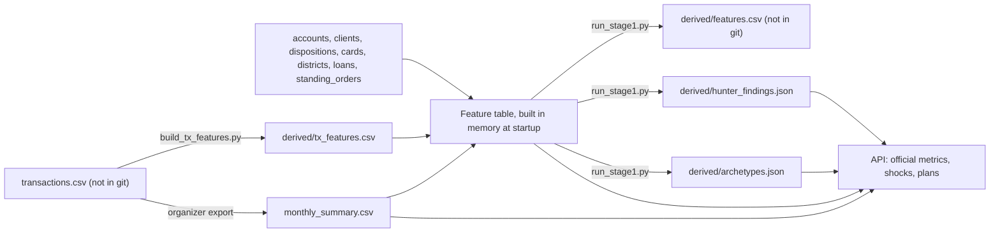

# Data

The Tangerine track CSVs live here and are committed, so fresh clones, the Vultr host and git-triggered Vercel builds
all have them. Only the 100 MB `transactions.csv` stays out of git. To use another folder, set `PULP_DATA_DIR` (the
older `EVERPATH_DATA_DIR` still works). The backend also auto-detects a sibling folder matching `data-*/data/` (the
Google Drive export name).

## How the files are used



## Files used

| File | Rows | Used for |
|---|---|---|
| `monthly_summary.csv` | 185,326 (4,500 accounts, 2020-01 to 2025-12) | All official sponsor calculations (I, S, F, H, B), history charts, cohort matching, simulation calibration, most behavioural signals |
| `loans.csv` | 682 | Active loan payment P (status C or D = running at the end of 2025) and the loan-outcome check (status B or D = went bad; 76 loans) |
| `accounts.csv` | 4,500 | Validating account IDs, branch district, statement frequency, account age |
| `clients.csv` | 5,369 | Owner age and gender, and the owner's home district, for the persona and the demographic insights |
| `dispositions.csv` | 5,369 | Who can use the account: owner only, or shared with another person (a joint household) |
| `cards.csv` | 892 | Card type on the account (junior, classic, gold) |
| `districts.csv` | 77 | District name and region, average salary, unemployment in 2022 and 2023, urban share, entrepreneurs and crime per 1,000 inhabitants |
| `standing_orders.csv` | 6,471 | Recurring obligations and unlabelled standing orders (a snapshot, undated) |
| `transactions.csv` | not here | Not loaded by the API (100 MB). `monthly_summary` is derived from it, and `backend/scripts/build_tx_features.py` turns it into `derived/tx_features.csv` |

## Derived files

| File | In git | Built by | Holds |
|---|---|---|---|
| `derived/features.csv` | No (git-ignored) | `backend/scripts/run_stage1.py`, as an inspection copy. The API does not read it: it builds the same feature table in memory at startup | The behavioural signals per account (79 in the live table) |
| `derived/tx_features.csv` | Yes | `backend/scripts/build_tx_features.py` | Payday and bill dates, penalty interest, recurring transfers to one partner |
| `derived/archetypes.json` | Yes | `backend/scripts/run_stage1.py` | The six behavioural groups over 4,500 accounts, with Gemini names when a key was set |
| `derived/hunter_findings.json` | Yes | `backend/scripts/run_stage1.py` | Pattern Hunter findings and the loan-outcome validation |

Without the committed derived files the API computes offline versions at startup, which is slower and uses rule-based
names.

## Credit and meaning

Credit: PKDD'99 Discovery Challenge Financial dataset, CTU Prague Relational Dataset Repository
(https://relational.fel.cvut.cz/dataset/Financial), supplied via the Tangerine track of Sheridan Datathon 2026. All
money columns are in Canadian dollars per the event README, and the source dates are shifted forward (the monthly
records here run from January 2020 to December 2025). The data is real, anonymized bank data. It is not PULP's, and no
record is treated as belonging to any identified person. The personas PULP builds for accounts are fictional. District
names keep the Czech source geography.

## Full-export reconciliation

From the repository root, run:

```powershell
python backend/scripts/validate_pulp_data.py --data-dir data-20261107T180312Z-1-001/data
```

Replace the path with your organizer export. The script checks account references, duplicate monthly keys, category
totals and every transaction's sign, then aggregates in integer cents and reconciles inflows and outflows to the monthly
summaries. It writes [docs/data-validation.json](../docs/data-validation.json). The verified export contains 4,500
accounts, 185,326 monthly rows and 1,056,320 transactions, with zero-cent reconciliation differences. The runtime
`data/` folder does not include transactions.

Supplementary research is reproducible with `python backend/scripts/pulp_research.py`:
[results](../docs/pulp-findings.json). Its 3,660-account longitudinal cohort and 4,500-account deciles are separate
from the original [matched-pair research](../docs/findings.md); do not interchange their denominators.
