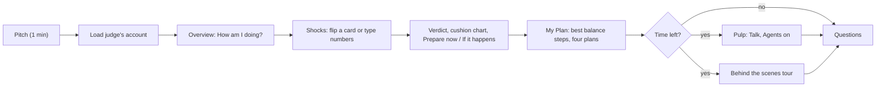
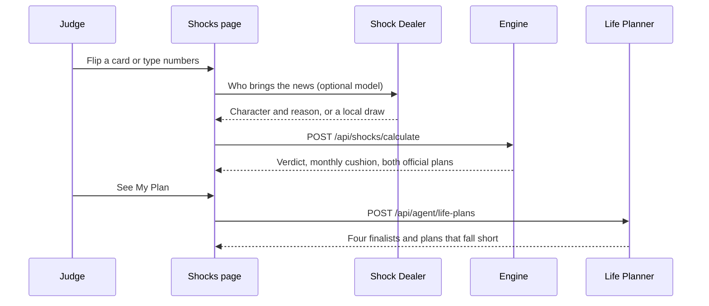

# PULP demo: pitch, live twist and video

Judging takes about 5 minutes: 1 minute of pitch, 3 minutes of live twist, 1 minute of questions. The Devpost demo
video runs 2 to 3 minutes.

Before you start:

- Open https://askpulp.com in one tab. Skip the short intro if it plays (it only plays once per browser session).
- Keep the Pulp panel closed. Leave the page in **Simple** view (the switch beside each page title).
- Load account 74916 from the account chip in the header, so the chip reads "74916 · Élise".

## The flow at a glance

## 1. Pitch (1 minute)

> "Most people find out how fragile their money is the day something goes wrong. PULP reads a customer's bank records
> and answers four questions before it happens: how am I doing, what if life happens, what should I do, and how do I
> compare.
>
> Here's account 74916. In a typical month $12,406 comes in and $12,159 goes out. [Overview] PULP's biggest discovery
> for Élise: never negative, yet fails a layoff. The record is spotless, but on 55% income the cushion lasts about
> 3.1 months, not six. Nearly a third of accounts (31%) share that blind spot.
>
> And that's our biggest finding across all 4,500 accounts: spending, not savings, decides who makes it. Grouped by
> cash on hand, six-month survival stays between 57 and 73 percent, with no trend. Grouped by how much of income goes
> back out, it falls from 99 to 25. And it holds up against what really happened: accounts our engine says fail a
> layoff later had their loan go bad three times as often (14.3% against 4.8%)."

## 2. Live twist (3 minutes)

1. **Load the judge's account.** Click the account chip in the header, type the ID in the account field and press
   **Load account**. The chip changes to the new ID and the persona's first name.
2. **Overview ("How am I doing?").** Read the one-sentence answer under the question: what a typical month leaves or
   lacks, and how many months the cushion covers. Point at the biggest discovery card below it.
3. **Shocks ("What if life happens?").** Turn over the matching card (Laid off, The furnace dies, or Layoff and bills),
   or type the judge's exact numbers (Income retained, Household bills change, One-time cost, Duration) and press
   **Run shock**. Never swap a preset in for the judge's numbers.
4. **Read the answer and the cushion chart.** The answer sentence says whether the cash lasts the period and by how
   much ("your cash would run out after about Y months, and you would be about $Z short by month 6", or "you would get
   through the 6 months with about $X left"). The bars show the cushion at the end of each month; red below zero is
   the shortfall.
5. **The numbers behind this shock.** On the same page: **Prepare now** (cash target, still to save, time to reach the
   target) and **If it happens** (extra cash needed today, what to free up each month, total shortfall if nothing
   changes).
6. **My Plan ("What should I do?").** Press **What should I do? See My Plan** at the end of the shock results. The
   answer sentence names the recommended plan; the Best balance plan's numbered, dated steps are below it. Say: "All
   four finalists are here. The agents built about 300 plans and dropped the ones that do not fit this person's life."
   **See the numbers behind this shock** leads back to the Shocks tables.
7. **If there is time:** press **Ask Pulp**, then the microphone, and say "what happens if I lose my job?". Turn on
   **Agents** in the panel header to show the workflow beside the chat. Or press **Explain this** on the cushion chart.
   Or open **Behind the scenes** at the right of the tab bar for the guided tour.

Fallback: if anything is slow, every official number is on the Shocks page without AI. The Shock Dealer falls back to
a local draw, and the agents label themselves offline when no model runs.

For 74916 the official presets give (from `/api/shocks/calculate`):

| Card | Answer | Prepare now | If it happens |
|---|---|---|---|
| Laid off (55% for 6 months) | Cash runs out after about 3.1 months; about $15,334 short by month 6 | Target $32,016; $15,334 still to save | Free up about $2,556 a month |
| The furnace dies (one month of spending, $12,159) | Gets through 6 months with about $6,003 left | Target covered | Nothing to free up |
| Layoff and bills (55%, bills up 15%) | Cash runs out after about 2.8 months; about $19,461 short by month 6 | Target $36,143; $19,461 still to save | Free up about $3,244 a month |

### What happens during a live twist

A card only sets the calculator's inputs. Every amount on screen comes from the engine.

## 3. Questions to expect

- **"Where do the numbers come from?"** The judges' definitions, implemented and tested (234 backend tests). No model
  produces a number; the agents only choose, ask and phrase.
- **"Is the finding real or simulated?"** The survival split is simulated with the official formula. The loan check
  uses recorded outcomes (loan status in loans.csv): loans went bad in 14.3% of accounts that fail the layoff test,
  against 4.8% of accounts that hold.
- **"Who is Élise?"** A fictional person built to fit the anonymized records, labelled as such, so a short demo can
  start from a plausible life. Anything the persona "says" can be corrected or undone.
- **"What does a customer actually gain?"** See "What PULP gives you" on Overview: time (years of statements read in
  seconds), money (avoidable costs found in their own records and the shortfall a plan prevents), perspective (the
  blind spot) and control (four real plans, every profile change undoable).
- **"What did the agents actually do?"** Open **Behind the scenes** (the guided tour at /tour): three chapters built
  from the account's recorded trace, its profile change log and one real plan search.

## 4. Demo video (2 to 3 minutes), shot list

| Time | Shot | Say |
|---|---|---|
| 0:00 | Intro, then Overview for 74916 | The problem in one line; the answer sentence: money left each month, cushion in months |
| 0:20 | Biggest discovery card | "Never negative, yet fails a layoff" |
| 0:35 | Shocks: flip "Laid off" | The answer sentence, the cushion chart, Prepare now and If it happens |
| 1:05 | Shuffle and deal from Élise's personal deck on Shocks | "A deck dealt for this life" |
| 1:20 | My Plan: the answer sentence, Best balance steps, the four plans | About 300 plans tried; why each step |
| 1:50 | Pulp voice: "I might lose my job" with Agents on | Agents passing work, profile updated, undo |
| 2:20 | Insights: spending versus savings cups, loan check | The finding, recorded against simulated |
| 2:40 | Behind the scenes: tour chapter 3 in Simple view | "One shock, hundreds of plans, four kept" |

## Rehearsal accounts

| Account | Persona | Why |
|---|---|---|
| 74916 | Élise, 58, shared account, rural district, cash wages | Never negative, yet fails a layoff (about 3.1 months on 55%); Life Fit rules out demanding plans |
| 20111 | Ethan, 60, manages money alone, rural, irregular cash income | Goes negative on timing, not shortage; has a loan; "Start CPP at 60" can appear among the plan steps (offered at ages 58 to 63 without a pension) |
| 47788 | Leila, 21, Prague, cash-paid service work | Thin margin; never negative, yet fails a layoff (about 5.6 months on 55%) |
| 88789 | Arjun, 40, rural, self-employed | Has lived through income drops of 40% or more and stayed above zero |

Persona names come from the Persona Builder and can change if a profile is rebuilt; the account IDs and record-based
facts do not.
