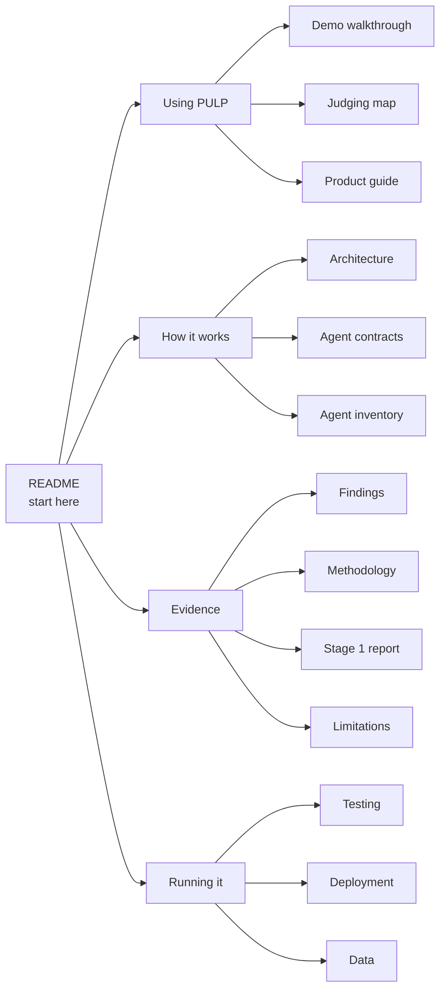

# PULP documentation

Start with the [repository README](../README.md): what PULP does, the site page by page, how the numbers and plans are
computed, the agents, local setup, tests and credits. Everything below goes deeper.

## Using PULP

| Document | Read it for |
|---|---|
| [Demo walkthrough](../demo/demo-script.md) | The pitch, the live twist step by step, and the rehearsal account |
| [Judging map](judging.md) | Where each judging criterion is shown on the site |
| [Product guide](product.md) | Design principles: one question per tab, Simple and Full detail, Pulp’s voice |
| In-app tour (`/tour`) | A guided, skippable walk through what every agent did for one account |

## How it works

| Document | Read it for |
|---|---|
| [Architecture](architecture.md) | Every layer, with diagrams: Stage 1 pipeline, a conversation turn, voice, the profile log, the plan search, storage, the full API map, hosting |
| [Agent contracts (v2)](agents/v2-contracts.md) | Personas, the profile log and undo, personal shocks, the Shock Dealer, the plan search and its objective, stream events |
| [Agent inventory](agents/README.md) | Which agents run today, in which file, and what is still a proposal |
| In-app developer docs (`/developers`) | Every API endpoint with examples, the agent flowchart, the stack and the infrastructure |

## Evidence

| Document | Read it for |
|---|---|
| [Findings](findings.md) | The research questions, comparisons and denominators |
| [Methodology](methodology.md) | The sponsor formulas and the evidence behind scenario calculations |
| [Stage 1 report](stage1-report.md) | Everything Stage 1 learns from the data, in plain language and in technical detail |
| [Limitations](limitations.md) | What the data and the engine cannot tell you |
| [Tangerine challenge](tangerine-challenge.md) | The event requirements and the supplied data dictionary |

## Running it

| Document | Read it for |
|---|---|
| [Testing](testing.md) | Backend, browser and voice checks, and what each covers |
| [Deployment](deployment.md) | Hosting on Vultr, health checks and recovery |
| [Data](../data/README.md) | The CSVs, the derived files and how to rebuild them |

The dataset results and validation artifacts are in [findings.json](findings.json), [pulp-findings.json](pulp-findings.json)
and [data-validation.json](data-validation.json). Regenerate the Stage 1 report with
`python backend/scripts/build_stage1_report.py`.

Files under `docs/agents/` numbered `01` to `06` and `prompts/` are an earlier design proposal kept for reference; they
are not the running system. The [agent inventory](agents/README.md) says which is which.
