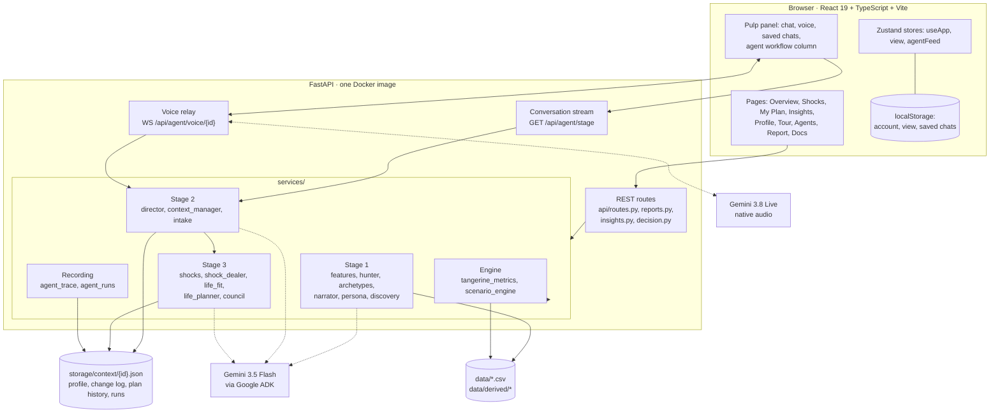
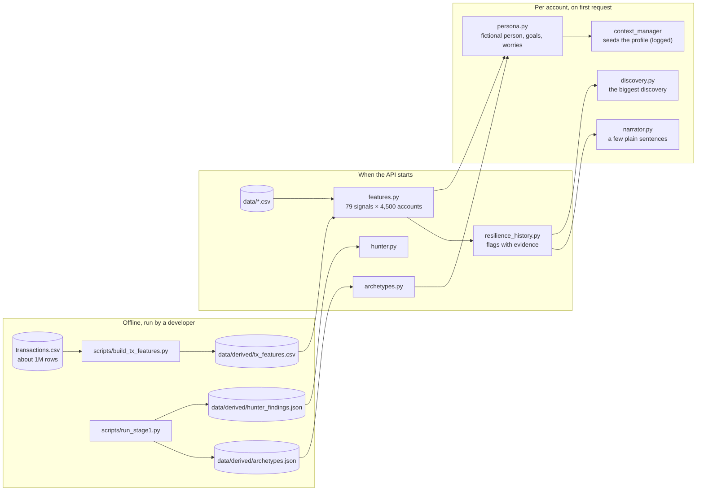
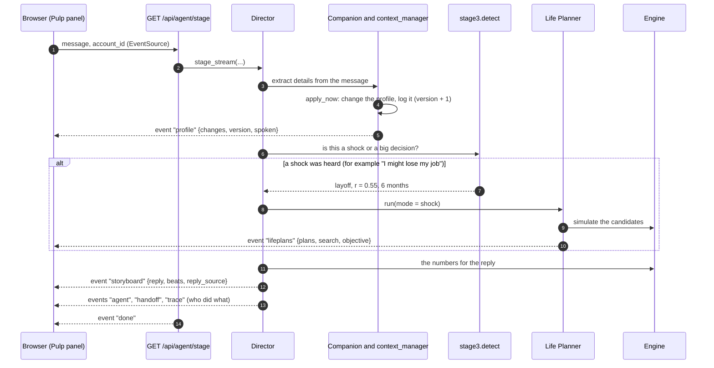
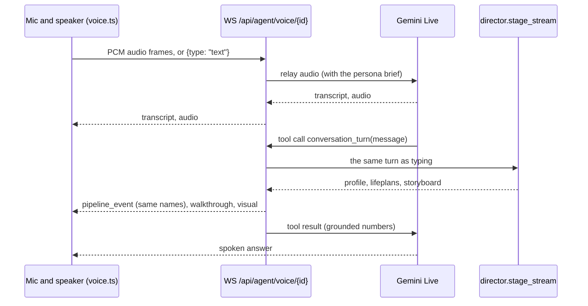
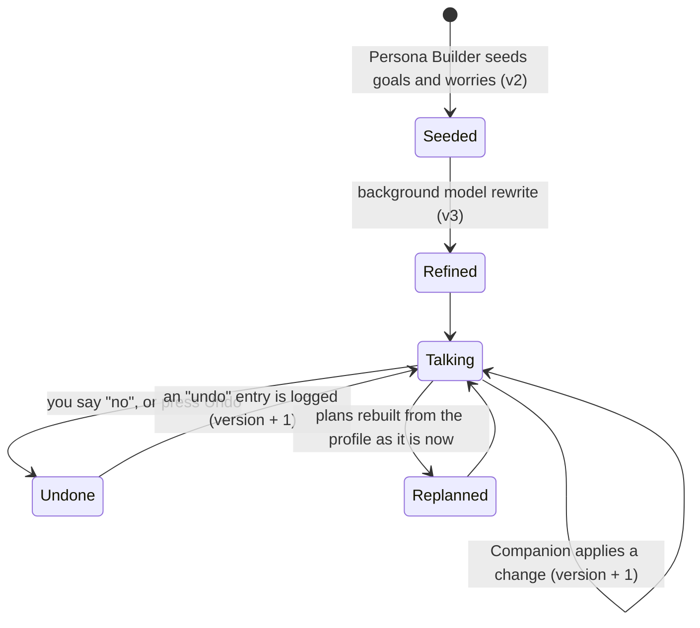
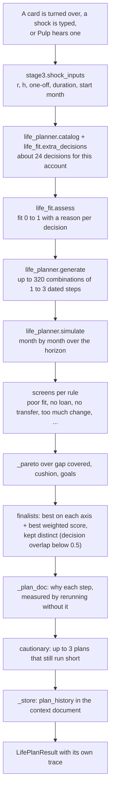
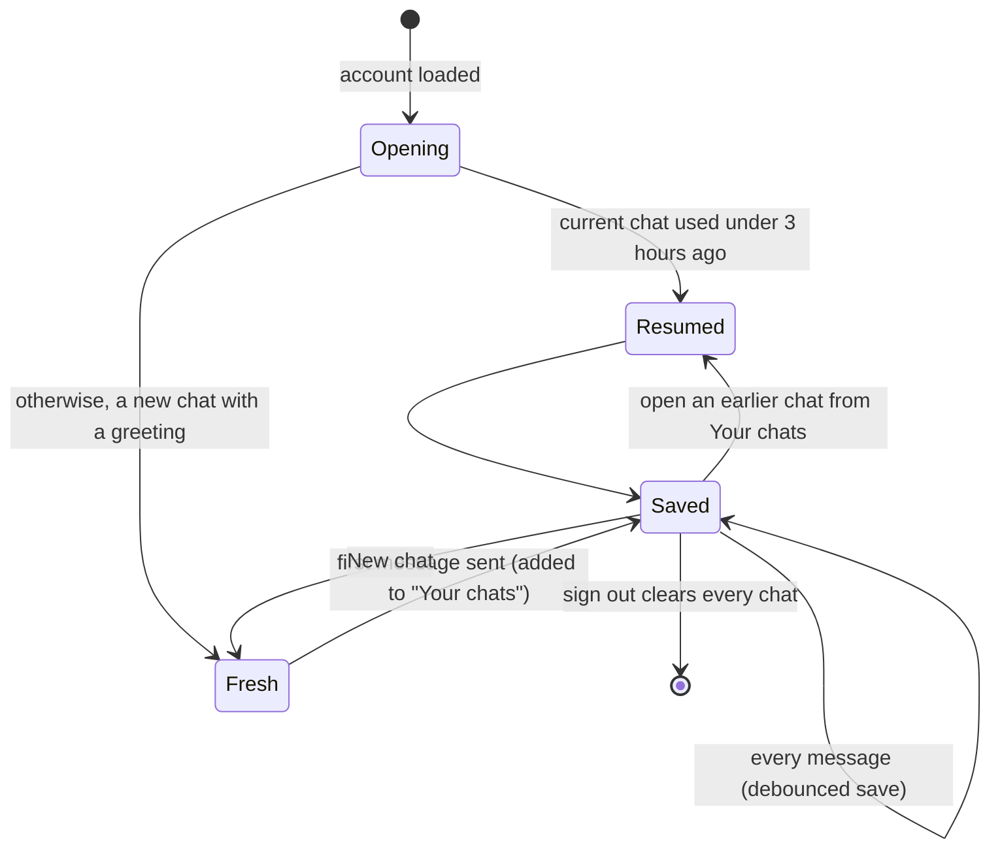
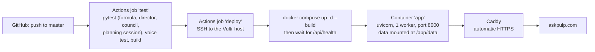

# Architecture

How PULP is put together, from the CSV files to the page in your browser. Reconciled with the code on November 9, 2026.
Start with the [README](../README.md) for what PULP does; this page is for people who want to change it.

**The rule everything follows:** agents interpret, code calculates. Models choose what to look at, what to ask and how to
say it. Every number shown comes from deterministic Python, and every model output that contains a number is checked
against the engine (or thrown away) before it reaches the screen.

---

## 1. The big picture

Dotted lines are optional: with no `GEMINI_API_KEY`, every model role falls back to deterministic code and the trace
labels those turns as offline. The engine, the official numbers, the twist cards, the plan search and the tour need no
model at all.

---

## 2. Where the code lives

### Backend (`backend/app/`)

| Layer | Files (under `services/` unless noted) | Responsibility |
|---|---|---|
| HTTP | `api/routes.py`, `api/reports.py`, `api/insights.py`, `api/decision.py` | REST endpoints and the SSE conversation stream |
| Voice | `api/voice.py` | Gemini Live socket, audio relay, `conversation_turn` delegation |
| Engine | `tangerine_metrics.py`, `scenario_engine.py`, `financial_profiles.py` | The judges’ formulas, shock reports, reproducible projections |
| Records | `data_store.py`, `features.py`, `resilience_history.py` | Loading CSVs through explicit column roles, 79 behavioural signals, historical patterns and flags |
| Stage 1 | `hunter.py`, `archetypes.py`, `narrator.py`, `persona.py`, `persona_voice.py`, `goal_ideas.py`, `discovery.py`, `demographics.py`, `stage1_report.py` | Research findings, clusters, prose, the fictional persona, goal ideas, the biggest discovery |
| Stage 2 | `director.py`, `context_manager.py`, `intake.py`, `gemini_agent.py`, `explain.py` | Turn orchestration, the profile and its change log, extraction, plain explanations |
| Stage 3 | `stage3.py`, `shocks.py`, `shock_dealer.py`, `life_fit.py`, `life_planner.py`, `council.py`, `life_actions.py` | Hearing a shock, the personal deck, fit scoring, the plan search, the council |
| Recording | `agent_trace.py`, `agent_runs.py` | Stage traces and replayable runs (40 runs per account, 120 events each) |
| Other | `financial_overview.py`, `roadmap.py`, `strategy_optimizer.py`, `benefits.py`, `cohort_analysis.py`, `adk_runtime.py`, `vultr_inference.py` | Balances, next steps, goal strategies, the “What PULP gives you” summary, peers, model runtime |
| Config | `config.py` | Paths (`PULP_DATA_DIR`, `PULP_STORAGE_DIR`), model names, keys |

### Frontend (`frontend/src/`)

| Area | Files | Responsibility |
|---|---|---|
| Shell | `App.tsx`, `components/Layout.tsx`, `components/workspace.tsx`, `header.css`, `brand.css` | Routes, header (logo, account chip, Ask Pulp), four tabs, Behind the scenes link, footer, Simple and Full detail |
| Tabs | `pages/Overview.tsx`, `ShockLab.tsx`, `Plan.tsx`, `Insights.tsx`, `components/PageAnswer.tsx` | One question and one answer per tab, then the detail |
| Account | `pages/Profile.tsx`, `Twin.tsx`, `Goals.tsx`, `Roadmap.tsx`, `Briefings.tsx` | The person, balances, goals, next steps, briefings |
| Behind the scenes | `pages/Tour.tsx`, `components/tour/*`, `pages/Agents.tsx`, `components/agents/*`, `pages/Report.tsx`, `pages/Docs.tsx` | The guided tour, the agent runs, the Stage 1 report, the developer docs |
| Pulp | `components/pulp/PulpPanel.tsx`, `PulpLauncher.tsx`, `services/voice.ts` | Chat, voice, saved chats, the launcher with its expressions and hints |
| Visuals | `components/stage/*Visual.tsx`, `components/insights/JuiceCups.tsx`, `components/plans/*` | The pictures (juice glass, cushion bars, shuffle, cups, plan search) |
| State | `stores/useApp.ts`, `stores/view.ts`, `stores/agentFeed.ts` | Account and shock inputs, view mode, live agent activity |
| Client | `services/api.ts` | Typed API client and every response type |

---

## 3. Stage 1: from records to a person

Stage 1 runs before anyone says a word. The heavy parts run offline and are committed, so the server starts fast.

- **Schema Scout** is a fixed map from this dataset’s columns to roles (`features.py`, `ROLES`). Automatic mapping for
  another bank’s export is not implemented.
- **Pattern Hunter** is an ADK agent with a budget of 24 exploration calls (recording a finding does not count) and tools (`list_features`, `describe`,
  `survival_by_quantile`, `correlation`, `compare_flag`, `crosstab_survival`, `record_finding`). It chooses the tests;
  the tools compute every number. Without a key, a deterministic battery runs instead.
- **Archetype Namer**: k-means with k = 6 and a fixed seed groups the accounts in code; the model only names them.
- **Persona Builder** builds the persona from code (sizes, weights, evidence) and, in the background, lets the model
  rewrite the words. A rewrite that adds a digit is rejected.

---

## 4. Stage 2: a conversation turn

Typed messages and voice share one function, `director.stage_stream`, so they can never disagree.

**Stream events:** `agent`, `handoff`, `memory`, `trace`, `profile`, `lifeplans`, `storyboard`, `done`, `error`. The
voice relay forwards the same names inside `pipeline_event` messages.

**Commands the chat understands** (sent as the message text): `__intro__`, `explain:<topic>?…`,
`twist:random`, `twist:<card_key>`, `twist:<card_key>@<character_id>`, `decision:small`, `decision:big`.

### Voice

Browser message types: `ready`, `transcript`, `turn_complete`, `walkthrough`, `visual`, `context_proposal`,
`pipeline_event`, `state_changed`, `status`, `error`, `closed`. A server restart drops a live call; reconnect from the mic.

---

## 5. The profile and its change log

The profile (goals, worries, constraints, preferences, upcoming events) lives in the account’s context document. Agents
change it directly; every change is an entry with who, what, before, after, why and the new version.

- `context_manager.apply_now(...)` applies and logs; `undo(change_id)` reverses one entry and logs the reversal.
- `POST /api/profile/{id}/undo/{change_id}` exposes undo to the History tab and the chat.
- Plans read the profile at run time, so weights move with what you said (a worry about your job moves weight toward
  the cushion).

---

## 6. Stage 3: from a shock to four plans

The month-by-month simulation: spare money fills the cushion, then goals by weight; a gap drains the cushion, then goal
savings, then becomes shortfall. The objective is in the [README](../README.md#how-the-plans-are-chosen) and in
[agent contracts](agents/v2-contracts.md).

The older **council** (`council.py`, `POST /api/agent/plan`) still runs for the Shocks page: a deterministic grid,
optional Strategist proposals that code clamps and re-scores, an optional Challenger review of the scored set, then
ranking. Strategist and Challenger run in sequence, not in parallel.

---

## 7. What is stored where

| Store | Where | What | Lifetime |
|---|---|---|---|
| Source records | `data/*.csv` | The supplied tables | Read-only |
| Derived features | `data/derived/` | `features.csv`, `tx_features.csv`, `archetypes.json`, `hunter_findings.json` | Rebuilt by the scripts |
| Context document | `backend/app/storage/context/{id}.json` (`PULP_STORAGE_DIR`), or Redis REST | Profile, change log, conversation history, plan history, agent runs, persona doc | Until deleted (`DELETE /api/context/{id}`) |
| Saved chats | Browser `localStorage`: `pulp.chats.{id}` (index), `pulp.chat.{id}.{chatId}` | Up to 20 chats per account, visuals included, plan results trimmed | Until sign-out |
| Preferences | Browser `localStorage` | Loaded account, Simple or Full detail, mute, agents column | Until cleared |

### Saved chats in the browser

A single long thread saved by an earlier version is converted once into the first saved chat (“Earlier: …”).

---

## 8. Full API map

The in-app developer docs at `/developers` list request and response examples; FastAPI’s schema is at `/docs`.

| Area | Routes |
|---|---|
| Status | `GET /api/health`, `GET /api/agent/status`, `GET /api/accounts/sample` |
| Customer | `GET /api/customers/{id}`, `/history`, `/cohort`, `/insights`, `/overview`, `/briefing`, `/discovery`, `/benefits` |
| Demographics | `GET /api/insights/demographics/{id}` |
| Official numbers | `POST /api/shocks/calculate`, `POST /api/shocks/compare-purchase` |
| Scenarios | `POST /api/scenarios/simulate`, `GET /api/scenarios/branches/{id}` |
| Goals and steps | `POST /api/strategies/compare`, `GET /api/roadmap/{id}`, `POST /api/decisions/compare`, `POST /api/decision/interpret` |
| Research | `GET /api/research/summary`, `/archetypes`, `/hunter`, `/features`, `/validation`, `/pulp` |
| Conversation | `GET /api/agent/stage` (SSE), `WS /api/agent/voice/{id}`, `POST /api/agent/explain`, `POST /api/agent/chat` |
| Profile | `GET /api/profile/{id}`, `GET /api/profile/{id}/goal-ideas`, `POST /api/profile/{id}/goals`, `POST /api/profile/{id}/undo/{change_id}`, `POST /api/profile/{id}/rebuild` |
| Context | `GET/DELETE /api/context/{id}`, `POST /api/context/propose`, `/confirm`, `/edit` |
| Twist cards | `GET /api/agent/deck`, `POST /api/agent/shock-dealer`, `GET /api/agent/characters` |
| Plans | `POST /api/agent/life-plans`, `GET /api/plans/history/{id}`, `POST /api/agent/plan`, `GET /api/agent/session/{id}`, `POST /api/replan`, `GET /api/replan/{id}/diff` |
| Agents | `GET /api/agent/personas`, `GET /api/agents/trace/{id}`, `GET /api/agents/runs/{id}`, `GET /api/agents/runs/{id}/{run_id}`, `GET /api/agent/run` |
| Report | `GET /api/report/stage1` |

---

## 9. Hosting

The image is built in two stages (Node builds the frontend, Python serves it with the API). It runs one worker, so
process-local locks are enough; this is not a distributed transaction. The public demo has no per-user authorization.
See [deployment](deployment.md) and [limitations](limitations.md).

---

## 10. Changing things safely

- **A new number:** add it to the engine and a test in `backend/tests/`; let agents only refer to it.
- **A new agent:** give it a contract in [agents/v2-contracts.md](agents/v2-contracts.md), a deterministic fallback,
  and a `trace` event so it shows up on the Agents page and in the tour.
- **A new page:** add it to `workspace.tsx` (a tab, an account page or a How it works page) so the heading, Simple view
  and footer work, and add a browser test that checks it fits a phone.
- **Before pushing:** run the four checks in [testing](testing.md). Every push to `master` deploys.
