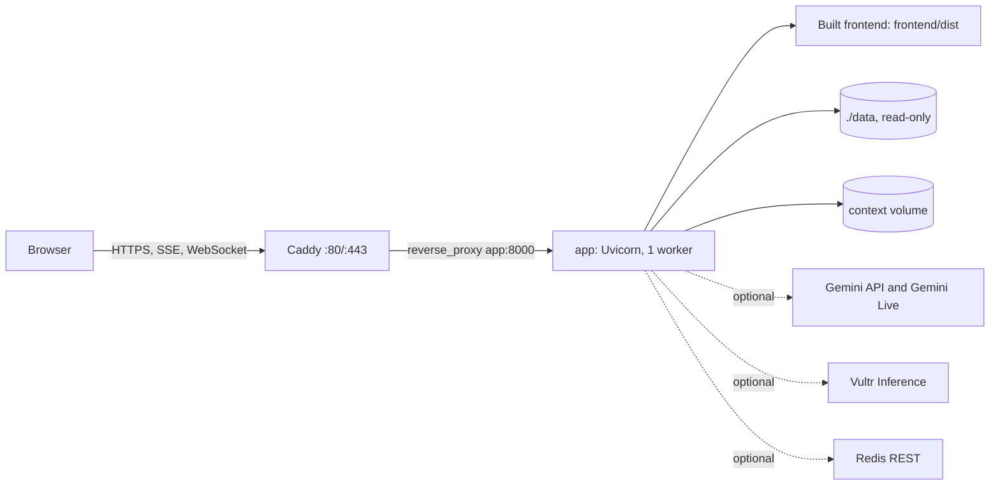
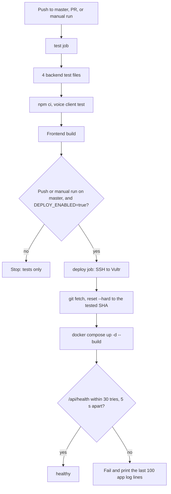

# Deployment and operations

## Primary deployment

**askpulp.com** is the primary application. The React build, the FastAPI API, the SSE conversation stream and the
native Gemini Live WebSocket (`/api/agent/voice/{account_id}`) all run together on one Vultr host behind Caddy.
[`deploy/Caddyfile.askpulp`](../deploy/Caddyfile.askpulp) serves `askpulp.com` (plus the host's `sslip.io` alias) and
permanently redirects `www.askpulp.com`, `askpulp.ca` and `www.askpulp.ca` to `https://askpulp.com`. It also sets HSTS,
`nosniff` and a referrer policy, and compresses responses.

The Vercel configuration ([`vercel.json`](../vercel.json), [`api/index.py`](../api/index.py)) remains as a secondary
mirror. It runs the API as a Python serverless function with no WebSocket, so live voice does not work there, and its
context storage is `/tmp` unless Redis REST variables are set. Do not use it to verify the complete experience or
assume it matches the Vultr host.

### What runs where



## Stack and persistence

[`Dockerfile`](../Dockerfile) builds the frontend with Node 22, then runs Python 3.12 with one Uvicorn worker on port
8000. The image includes `backend/`, `docs/` (read by the in-app developer docs and report) and the built frontend; it
has a built-in health check on `/api/health`. [`docker-compose.yml`](../docker-compose.yml) defines:

- `app`: the image above. The host's `./data` is mounted read-only at `/app/data`.
- `caddy`: HTTPS and WebSocket/SSE proxying on ports 80 and 443 (TCP and UDP). `CADDYFILE` picks the configuration;
  the default is `./deploy/Caddyfile` (one host from `DOMAIN`).
- `context`: a named volume for per-account context at `/app/backend/app/storage/context`.
- `caddy_data` and `caddy_config`: certificate and proxy state.

The server checkout is `/opt/pulp`. Source data is mounted, not baked into the image. The summary CSVs and the committed
derived files are in the repository's `data/` folder, so a fresh checkout already has what the API needs
(`transactions.csv` is not included and not needed). The feature table is built in memory at startup, so
`data/derived/features.csv` is not needed either.

Back up the context volume before destructive maintenance. `docker compose down -v` removes named volumes, including
saved context; it is not a routine redeploy command.

## Configuration

Copy [.env.example](../.env.example) to `.env` and fill in real values privately. Never commit `.env` or private keys.

| Variable | Function |
|---|---|
| `DOMAIN`, `CADDYFILE` | Public host and proxy configuration; production uses `askpulp.com` and `./deploy/Caddyfile.askpulp` |
| `GEMINI_API_KEY`, `GEMINI_MODEL` | Gemini extraction and ADK text roles; without a key the companion runs offline |
| `GEMINI_LIVE_MODEL`, `GEMINI_LIVE_API_VERSION`, `GEMINI_LIVE_VOICE` | Native audio configuration; the repository's default voice is Aoede |
| `AI_PROVIDER` | Companion and extraction selection: `auto`, `gemini`, `vultr` or `offline`; it does not make Vultr a Gemini Live replacement |
| `VULTR_INFERENCE_API_KEY`, `VULTR_INFERENCE_MODEL`, `VULTR_INFERENCE_BASE_URL` | Optional companion and extraction provider |
| `PULP_DATA_DIR` / `EVERPATH_DATA_DIR` | Data location outside the default; Compose sets `EVERPATH_DATA_DIR=/app/data` |
| `PULP_STORAGE_DIR`, `PULP_DERIVED_DIR` | Optional writable context and derived-artefact locations |
| `KV_REST_API_URL`, `KV_REST_API_TOKEN` | Optional Redis REST persistence; `UPSTASH_REDIS_REST_URL` and `UPSTASH_REDIS_REST_TOKEN` also work |
| `PULP_ALLOWED_ORIGINS` | Extra comma-separated CORS origins |

The committed model names are application defaults. Check availability with the configured provider; do not copy old
quota or latency claims into an SLA. Live audio needs microphone permission and a secure browser context (HTTPS in
production, localhost in development).

For a new host, read [`deploy/vultr-setup.sh`](../deploy/vultr-setup.sh) before running it. It installs Docker, opens
the firewall for SSH, HTTP and HTTPS, clones the repository to `/opt/pulp`, writes `.env` and starts the stack. Without
`DOMAIN` it uses `<public-ip>.sslip.io` so Caddy can still get a certificate (the browser only allows the microphone on
HTTPS). [`deploy/upload-data.sh`](../deploy/upload-data.sh) copies local CSVs and `.env` to a server if needed. Point DNS
at the host and choose the matching Caddyfile. Deployment credentials and server state are not in the repository.

## Automated release

[`.github/workflows/deploy.yml`](../.github/workflows/deploy.yml) is the authority. A push to `master` deploys, so run
the full local checks in [testing](testing.md) first.



1. Every push to `master`, pull request and manual dispatch runs the `test` job: the named backend subset, the voice
   client test and the frontend build.
2. Deployment needs a push or manual dispatch on `master`, the repository variable `DEPLOY_ENABLED=true`, and the
   `production` environment. Jobs share the `deploy-production` concurrency group, so releases never overlap.
3. Secrets: `VULTR_HOST`, `VULTR_USER` and `VULTR_SSH_KEY`.
4. The runner uses plain OpenSSH. It sends the exact tested `github.sha` to the server, fetches `master`, checks the
   commit exists, resets the checkout to it, rebuilds with `docker compose up -d --build --remove-orphans` and prunes
   old images.
5. An internal `/api/health` check must pass within 30 tries, 5 seconds apart. The runner deletes its temporary private
   key on exit. The job times out after 20 minutes.

The server checkout must not hold uncommitted work: the release resets it on purpose. The workflow gets host keys with
`ssh-keyscan`; it does not pin an independently verified fingerprint.

### Why the SSH action 504 issue changed

The deploy job no longer downloads a third-party SSH action or its release binary, which removes that dependency and its
download-504 failure. GitHub availability, network failures, SSH access, image builds and provider outages can still
fail a release. Start a new workflow run to pick up workflow changes; re-running an old run can keep its old workflow
definition.

## Verification and recovery

Read-only check after a release:

```sh
curl -fsS https://askpulp.com/api/health
```

The response reports `ok`, the number of accounts (4,500), whether Gemini is configured, the model, the context storage
mode and the AI provider.

On the deployment host:

```sh
cd /opt/pulp
git rev-parse HEAD
docker compose ps
docker compose logs --tail=100 app
```

Then check by hand: the expected frontend build is served; Overview loads a demo account and shows its answer sentence;
a shock runs on Shocks; Pulp answers a typed message and a short voice turn (microphone permission first); the Agents
toggle shows the workflow; and **Behind the scenes** opens the tour. Health alone does not prove model access or
conversation quality.

Do not use planning calls as a harmless probe. `POST /api/agent/life-plans` (also run by My Plan and by opening the
tour) stores the account's latest plan and adds to its plan history and agent runs. `POST /api/shocks/calculate` is a
pure calculation.

If a release fails, read the Actions log and the container logs, and rebuild only after finding the failed step. To roll
back, pick a known-good commit and deploy that exact revision through a reviewed change; keep the context and data
volumes. There is no automatic rollback.

## Local Docker check

From a checkout with `data/` and `.env` ready:

```sh
docker compose build app
```

Starting the whole stack also binds ports 80 and 443 and uses `DOMAIN` for certificates. For isolated UI regression
work, use the temporary browser-test server described in [testing](testing.md) instead.
