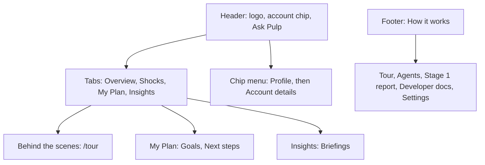

# Judging map

The [organizer brief](event-brief.md) supplies the criteria. This page maps them to the current screens. The pitch,
live-twist steps and video shot list are in the [demo script](../demo/demo-script.md); the Devpost text is in
[submissions/devpost-writeup.md](../submissions/devpost-writeup.md).

## Where things are

The app has four tabs. Each tab's heading is a question, answered by one sentence built from the loaded account's own
numbers.

| Tab | Question | What answers it |
|---|---|---|
| Overview (`/`) | How am I doing? | Money kept or short in a typical month, and how many months the cushion covers |
| Shocks (`/shock`) | What if life happens? | Whether the cash lasts the shock, and by how much |
| My Plan (`/plan`) | What should I do? | The recommended plan's first steps and where it leaves you |
| Insights (`/insights`) | How do I compare? | Where the account's cushion and spending share sit among all 4,500 accounts |

Other pages open from inside the tab they belong to: Goals and Next steps from My Plan, Briefings from Insights,
Profile from the account chip, Account details from Profile. **Behind the scenes** at the right of the tab bar opens
the guided tour. The footer's "How it works" lists Watch PULP work, Agents, Stage 1 report, Developer docs and Settings.

## Criteria

| Criterion | Weight | Where to show it |
|---|---|---|
| Discovery | 35% | Insights: spending versus savings (simulated, all 4,500 accounts), the check against recorded loan outcomes, the matched pairs, demographics; Overview: the account's biggest discovery |
| Data use | 25% | Overview and Shocks: the judges' exact formulas ("How the numbers work" in Full detail); Profile: a persona and personal goals built from 79 signals per account; the personal deck on Shocks; the Stage 1 report |
| Communication | 25% | One question and one answer sentence per tab; Simple and Full detail views; Explain this buttons; Pulp by text and voice; the month-by-month cushion chart; Watch PULP work (/tour) with a picture per step; the Agents page with replayable runs; the developer docs at /developers |
| Impact | 15% | My Plan: four distinct plans with dated steps and reasons, plans that fall short, the long-term plan; "What PULP gives you" on Overview |

## Live-twist sequence

1. Load the judge's account from the account chip in the header.
2. Shocks: turn over the matching official card, or enter the judge's exact inputs and press **Run shock**. Never
   substitute a generic preset for the judge's numbers.
3. Read the answer sentence, the cushion chart and both official plans under "The numbers behind this shock"
   (Prepare now, If it happens).
4. Follow **What should I do? See My Plan**: the Best balance plan's steps lead; the four finalists are on the same
   page. **See the numbers behind this shock** returns to the Shocks tables.

## Boundaries

All results are computed from historical, anonymized records. Survival results are simulations under the official
formula; the loan check uses recorded outcomes. Personas and their quotes are fictional. PULP has no live bank access,
no benefit-eligibility determination and never moves money.
