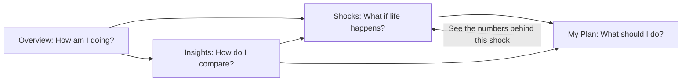

# Product and design guide

PULP is a financial planning workspace for one demo bank account at a time. It should feel considered and
professional while keeping the demo nature and evidence limits clear. A banking-style visual language is not a claim of
banking authorization, deposit protection or financial execution.

## One workspace, four questions

Page names, questions and destinations live in one catalog,
[`workspace.tsx`](../frontend/src/components/workspace.tsx). The tab bar, the footer, the back links and the page
headings all read from it, so no page is listed twice.

The four tabs (`PRIMARY_WORKSPACE`) each ask one question. The question is the page's `h1`, the tab name sits above it
as a small eyebrow, and one sentence straight after the heading answers it from the loaded account's own numbers
([`PageAnswer.tsx`](../frontend/src/components/PageAnswer.tsx)). The answer is a polite live region, so a new answer
(after a shock runs, say) is read out once it is ready. While there is nothing to answer yet it is shown muted.

| Tab | Route | Question (h1) | The answer sentence |
|---|---|---|---|
| Overview | `/` | How am I doing? | What a typical month leaves or lacks, and how long the cash cushion lasts |
| Shocks | `/shock` | What if life happens? | Whether the cash lasts the shock that was run, and by how much |
| My Plan | `/plan` | What should I do? | The recommended plan ("The best plan is ..." or "Start with ... and two more steps below") and where it leaves you |
| Insights | `/insights` | How do I compare? | Where the account's cash cushion and spending share sit among all accounts |

### Header

The header is calm: the logo (the PULP mark and wordmark, with "Planning Under Life's Pressures" spelled out on wide
screens), one account chip and an **Ask Pulp** button ([`Layout.tsx`](../frontend/src/components/Layout.tsx),
[`header.css`](../frontend/src/components/header.css)).

- The chip reads "74916 · Élise" (account ID and the persona's first name), or "Pick an account" when none is loaded.
  The name eases in only when you switch to a new account, not on reload.
- The chip opens a small account menu: **Your profile**, a **Switch account** field with **Load account**
  ([`AccountIdForm.tsx`](../frontend/src/components/AccountIdForm.tsx)), and **Sign out of demo**. An unknown ID is
  reported in the menu and the current account stays loaded. Escape or a click outside closes the menu.
- Sign-out asks for confirmation, closes Pulp, clears saved chats in this browser and returns to Overview.
- There is no separate "Account tools" menu.

### Pages inside a tab

Pages that belong to a tab are linked from inside it, not from the tab bar. While on one, its parent tab stays
highlighted and a back link sits above the title (`PARENT_OF` in `workspace.tsx`). Links between them use the shared
`MoreLinks` row.

| Route | Page | Reached from | Back link |
|---|---|---|---|
| `/profile` | Profile | Account chip menu, Overview, Insights | (the chip shows it as current) |
| `/twin` | Account details | Profile | Profile |
| `/goals` | Goals | My Plan | My Plan |
| `/roadmap` | Next steps | My Plan | My Plan |
| `/briefings` | Briefings | Insights | Insights |

### Behind the scenes and the footer

A muted **Behind the scenes →** link sits at the right of the tab bar, apart from the four customer tabs. It opens the
guided tour at `/tour` and stays lit on every "how it works" page (`/tour`, `/agents`, `/report`, `/developers`).

The site footer's **How it works** list holds: Watch PULP work (`/tour`), Agents (`/agents`), Stage 1 report
(`/report`), Developer docs (`/developers`) and Settings (`/settings`). `/docs` is FastAPI's interactive API reference
on the single-server build, which is why the written developer guide lives at `/developers`.

`/classic` and `/companion` redirect to `/`; `/explore` redirects to `/shock`; any unknown path redirects to `/`. Source
files such as `Stage.tsx`, `AgentHome.tsx` and `Companion.tsx` are not routed and are not active product surfaces.

## What each tab holds

- **Overview.** The answer, a quiet row with the record period, **Run a shock** and **View my plan**, the typical month
  (money in, money out, what is left, the cash cushion in Simple view, baseline runway), "See your month as a picture"
  with what-if sliders, the account's biggest discovery and "What PULP gives you" (time, money, perspective, control).
  Full detail adds the cash buffer and fixed-cost cards and a "What next?" block.
- **Shocks.** The answer, then "Set up a shock": three official twist cards (Laid off, The furnace dies, Layoff and
  bills) and a fourth card dealt from the account's own deck, with **Shuffle and deal** and **Look through the deck**.
  The four inputs (Income retained, Household bills change, One-time cost, Duration), **Run shock** and "This shock has
  already happened". Results: the cushion month by month (with two what-if sliders), the cash chart and "The numbers
  behind this shock" with **Prepare now** and **If it happens**. These tables live on Shocks only. A single **What
  should I do? See My Plan** link follows, then "Can a purchase wait?". Full detail adds "How the numbers work" and the
  optional planning council.
- **My Plan.** The answer, then a switch between **Long term** (the next five years with no shock) and **If a shock
  hits** (the shock set up on Shocks). With a shock, **Change shock** and **See the numbers behind this shock** link
  back to Shocks (`/shock#resilience-plans`, which scrolls to the tables once they load). The plans card shows the four
  finalists with dated steps and reasons. Links to Next steps and Goals follow. Full detail adds how the plans changed
  over time.
- **Insights.** The answer with two percentile bars (cash cushion, spending share), the account's evidence-linked
  insights, the research evidence (spending versus savings cups, the loan check, matched pairs), demographics in Full
  detail, and links to Briefings, Shocks, My Plan and Profile.

## Simple and Full detail

A **Simple / Full detail** switch sits beside each page title once an account is loaded
([`stores/view.ts`](../frontend/src/stores/view.ts)). Simple is the default and shows each page's main answer and the
evidence for it. Full detail shows everything. In Simple view, **Show full detail** at the foot of a page reveals the
rest of that page only. The choice is kept in this browser.

## Pulp, the chat panel

[`PulpPanel.tsx`](../frontend/src/components/pulp/PulpPanel.tsx) is a side panel with the conversation and the live
voice agent. Every number Pulp shows comes from the engine; profile changes are logged and can be undone.

### Ways in

- **The launcher** ([`PulpLauncher.tsx`](../frontend/src/components/pulp/PulpLauncher.tsx)): a floating pill with
  Pulp's face and an "Ask Pulp" label. While idle, Pulp shows an occasional expression (a wave, a nod, a small hop)
  every 11 to 19 seconds. A few times per visit a hint bubble about the current page peeks out (first after 6 seconds,
  then about every 50 seconds, at most four per browser session). Hints can be dismissed and stop once Pulp is opened.
  Reduced motion keeps Pulp still.
- **The header's Ask Pulp button.** On phones (600px and narrower) the launcher is hidden and this button shows Pulp's
  face instead of a label.
- **From a page:** **Explain this** buttons, **Ask Pulp about this card** on a revealed twist card, and "Talk it
  through with Pulp" on Overview (Full detail). These open the panel and send a first message for that topic.

### Saved chats

Each visit starts a fresh chat. A chat used within the last 3 hours is picked up again instead. Earlier chats are kept
per account in this browser and reopen from **Your chats** in the panel header; **New chat** starts another. Up to 20
chats are kept per account (the oldest drop off), each holding its last 60 messages with their visuals; plan results
are trimmed to stay small. Chats can be deleted one by one, and all of them are cleared on sign-out. Pulp's memory of
the profile is kept on the server, so it carries across chats.

### Panel controls

- The message field, a **Talk** (microphone) button that starts or stops a voice conversation (with a typed draft it
  sends the draft), and **Send**.
- **Agents** in the header widens the panel and shows the agent workflow live in a column beside the chat. It is off
  by default and remembered in this browser.
- Pop out visuals (open new visuals larger, on by default), mute, and close.
- There is no Shuffle button in the chat. Twist cards still reach the chat from the Shocks page.

### Conversation rules

- One native Gemini Live voice, started by the user. Typing during voice stays in the same session. Text-only replies
  are silent.
- Routine replies are short. Ask one useful missing question instead of forcing a visual or a long questionnaire.
- Explain a fact's relevance to a real choice. Distinguish observed records, details the person gave, modeled outcomes
  and unknowns.
- Personal details heard in the conversation are applied to the profile directly and logged. A "Pulp updated your
  profile" card shows each change with **Undo**; saying "no" right after takes the change back. This is personal
  context, not financial authorization.
- A plan candidate that still needs spending or work-capacity information stays an **Option to discuss**.

## Watch PULP work: the guided tour

[`Tour.tsx`](../frontend/src/pages/Tour.tsx) is a guided, skippable walk through what the agents did for the loaded
account. It uses only what the backend already recorded or computes; no number is staged.

| Chapter | Title | Built from |
|---|---|---|
| Intro | How PULP got to know (name) | The three chapter cards |
| 1 | From records to you | `GET /api/agents/trace/{id}` (stage 1), `/api/customers/{id}/insights`, `/api/customers/{id}/discovery`, `/api/profile/{id}`, `/api/research/validation` |
| 2 | How talking updates you | The profile change log (`GET /api/profile/{id}`) joined to the stage 2 trace |
| 3 | When life happens | One `POST /api/agent/life-plans` run (layoff at 55% for 6 months, no model) and its own trace, so every count agrees |
| End | That is the whole process | Links to the plan, the raw agent runs, the developer docs and the Stage 1 report |

Controls: **Back** and **Next**, the left and right arrow keys, **Skip chapter**, **Skip to the end**, **Autoplay**
(8 seconds a step, with Pause), and `?chapter=1`, `2` or `3` in the URL to start at a chapter. A chapter rail shows
progress.

In **Simple** view (the default) each step is one plain sentence and a picture: tables sorted into roles, juice cups
for how the account ranks, the plan "press" that squeezes hundreds of plans down to four, a card shuffle, a flipping
profile card, and stamped plans that look fine but fail. **Full detail** shows the technical view: each agent's input
and output, the trace events and the plan search.

Opening the tour runs one real plan search, so it is recorded as an agent run and added to the account's plan history.

## Visual system

- [`workspace.css`](../frontend/src/workspace.css) and [`refinement.css`](../frontend/src/refinement.css) supply the
  shared evergreen, parchment and copper palette and fine rules.
- [`simple.css`](../frontend/src/components/simple.css) sets one typeface (DM Sans) everywhere and three text sizes.
- [`brand.css`](../frontend/src/brand.css) adds the acronym lockup, faint citrus patterns and paper grain. On screens
  1360px and wider a green citrus pattern fills the empty side margins, fading out before the content. It is fixed
  behind everything, never moves the layout and is hidden in print.
- Shared chart colors are in [`charts/index.tsx`](../frontend/src/charts/index.tsx). Prefer these shared foundations
  over new page-specific palettes.

Figures stay optional. Text-heavy visuals grow with their content; detailed visuals can open larger. Preserve figure
animation and replay, and respect reduced-motion preferences.

The Agents view shows actual observed steps and handoff summaries; chronological activity is not labelled as a handoff.
It is a trace of events, not access to private model reasoning. Historical runs start paused; playback scrolls inside
the trace, not the whole page.

## Insights that lead somewhere

`ProfileInsights` shows evidence, its possible life effect, the decision it informs, and a question where context is
missing. The question is shown with the evidence; the person can answer it by talking to Pulp. Keep source periods, uncertainty and links to the decision
each observation informs. The persona on Profile shows its occupation as a labelled guess with a confidence and its
evidence, never as a fact.

Use progressive detail: a practical answer first, assumptions and source records available, full research and
advanced controls in Full detail. Do not add an agent simply to increase the count. A new role needs a defined input,
useful output, failure behavior and evidence that it improves a user decision.

## Financial overview and briefings

Account details (`/twin`) starts with user-reported assets and liabilities, goal-progress rings and a proportional
outflow allocation strip (`FinancialOverview.tsx`). Balance comparisons use a shared scale; goal rings show unknown
progress as a question mark rather than zero. All visual quantities have adjacent text. Details the person told Pulp
can be reviewed and removed there.

A balance sheet is dated and partial until the user marks it complete. Goal savings are allocations of assets, not
additional assets. Goal deadlines come from the goal's creation date plus its stated duration; monthly pace is a
remaining-gap calculation, not an affordability guarantee.

`/briefings` gives a daily focus and a trailing seven-day summary, generated when opened. They report the latest saved
personal updates, goals, existing plan options and missing questions; they are not an immutable change log or a claim
of new bank activity. Nothing is delivered automatically: no notifications or email.

Strategy simulations keep their historical buffer assumptions: reported assets are not automatically treated as
accessible cash, and current goal savings are not silently added to projected funds.

## Shocks and plans: keeping results honest

The shock page puts the answer, exact inputs, cushion and both official plans before optional extras. Changed inputs
hide the previous answer and plans until **Run shock** is pressed again, so old results never appear under new inputs.
My Plan only shows shock plans when the shock on Shocks matches the inputs; otherwise it asks you to set one up.

## Explainable financial stories and loan motivations

The evidence views include a plain-English `PersonProfile`. It describes recent account cash flow, the interpretation
it supports, confirmed goals and preferences, and borrowing context. A working account pattern is not presented as a
biography, personality type or occupation.

Loan facts are original principal, recorded start, scheduled payment, term and status at December 31, 2025. Current
outstanding balances and terms remain unknown. Evidence uses up to three calendar months immediately before
origination, excludes the origination month because monthly data cannot establish transaction order, and can compare
the following three complete calendar months excluding loan repayments. Fewer than three pre-loan months produce no
purpose hypothesis.

Repeated pre-loan deficits may suggest bridging a gap; uneven inflows may suggest smoothing cash flow; a later increase
in non-repayment outflows may suggest a larger expense. Each explanation is marked unconfirmed, cites its basis,
presents an alternative, and links to a question and a practical decision. These are heuristics, with no calibrated
likelihood or causal claim.

A person can save or correct their loan purpose. It is scoped to the account's recorded loan and updates conversation
context, decision questions and profile explanations. Confirmed purpose replaces all purpose hypotheses. No new
affordability or prepayment recommendation is generated from purpose alone.

## Responsive and interaction checks

Every main destination is checked at desktop (1440px) and phone (390px) widths for horizontal overflow. The header
never wraps; on phones the launcher is hidden and the header button shows Pulp's face. Wide financial tables scroll
within labelled regions. Keyboard focus, the account menu, dialog closing, message entry, account changes and the tour
controls must stay usable. The test suite checks important interactions and layout overflow; it does not establish
accessibility certification or human usability validation.
