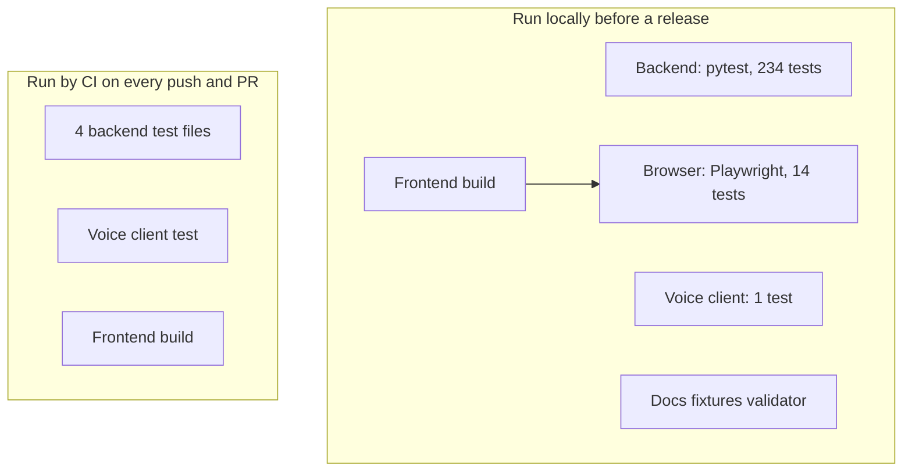

# Testing and verification

## Test layers



| Layer | File(s) | Count (November 9, 2026) | Needs |
|---|---|---|---|
| Backend unit and API | `backend/tests/test_*.py` (18 files) | 234 tests | Python 3.12; some tests need the dataset in `data/` |
| Voice client | `frontend/tests/voice.test.mjs` | 1 test | Node 22 only (fake media, mocked WebSocket) |
| Browser journeys | `frontend/tests/browser.test.mjs` | 14 tests | A built frontend, Google Chrome, port 8002 free |
| Historical doc fixtures | `docs/agents/validate_examples.py` | 2 fixtures, 39 local links | Python only |

The counts are a snapshot. Re-run the commands after a code change; do not treat these numbers as a fixed contract.

## Local release checks

Use Python 3.12 and Node 22 for parity with CI. Install dependencies and build the frontend before browser tests:

```sh
python -m pip install -r backend/requirements.txt
npm --prefix frontend ci
python -m pytest backend/tests -q
node frontend/tests/voice.test.mjs
npm --prefix frontend run build
npm --prefix frontend run test:e2e
python docs/agents/validate_examples.py
```

`test:e2e` runs `node --test --test-concurrency=1 tests/browser.test.mjs` from `frontend/`, so the tests run one at a
time.

## Isolation and requirements

Backend tests disable live provider keys and remote context storage and use temporary context directories. Some tests
need the supplied dataset.

Browser tests start `backend/scripts/browser_test_server.py` on port 8002. That server blanks `GEMINI_API_KEY`,
`VULTR_INFERENCE_API_KEY` and the Redis REST variables, sets `AI_PROVIDER=offline`, keeps context in a temporary
directory, and serves the built frontend from `frontend/dist`. The suite refuses to start if port 8002 is already in
use, so a developer's API or saved context is never touched. Every page also fails its test on any uncaught page error.

The browser suite uses Playwright with installed Google Chrome by default. `PULP_BROWSER_CHANNEL` picks another
installed channel, and `PULP_BROWSER_EXECUTABLE` points at a specific browser binary. Tests skip the opening intro
except the one that checks it. Most use demo account 90114.

## What the browser tests cover

The 14 tests in `browser.test.mjs`:

1. An unfamiliar account can be loaded by ID and survives a reload.
2. The combined shock shows matching cash and both plans, with a meaningful wait-or-pay decision.
3. Twist cards start face down, a reveal applies the official scenario, and each reveal brings a new character.
4. Insights distinguishes the home and branch records and labels modeled research.
5. Sign-out asks for confirmation and clears account restoration after a refresh.
6. Invalid IDs show feedback, and an unknown ID keeps the previous account.
7. Main destinations fit desktop (1440px) and mobile (390px) and keep the account. This checks exactly four tabs
   (Overview, Shocks, My Plan, Insights), each question as the `h1` with one answer sentence after it, and no
   "Account tools" menu.
8. The Agents page plays all three stages, and the Pulp panel shows the live workflow beside the chat.
9. A confirmed loan purpose can be corrected and survives a reload.
10. The opening is brief and can be replayed and skipped in Settings.
11. Account details drop the decisions block that Insights keeps, and findings pair cups with charts.
12. Simple view tucks detail away, Profile opens on tabs, and Explain this answers in the chat.
13. The developer docs list every endpoint group and fit a phone.
14. Behind the scenes opens the guided tour, which steps, skips chapters and fits a phone.

## What the backend tests cover

- Official metrics, shock presets against the formula, the loan payment rule, and simulation reproducibility
  (`test_tangerine_metrics.py`, `test_data_accounts.py`).
- Financial edge cases (fractional-cent shortfalls, negative and zero buffers, upfront needs), research counts
  reproduced independently, context confirmation and stale-proposal conflicts, and the native voice protocol without a
  key (`test_pulp.py`).
- The Director's turn orchestration and grounding (`test_director.py`); the council order, with Strategist validation
  before Challenger review (`test_council.py`); planning sessions and saved plan continuity
  (`test_planning_session.py`).
- The v2 agents (`test_v2_agents.py`, 35 tests): the persona and its goals, profile changes applied directly and undone
  by "no", the personal deck and world events, the Shock Dealer and its local fallback, Life Fit screening, the Life
  Planner's four distinct finalists and plans that fall short, Stage 3 from conversation, the biggest discovery, every
  Explain topic, and every agent run recorded and replayable.
- Loan-purpose hypotheses and confirmation (`test_life_profile.py`); engine levers turned into everyday decisions
  (`test_life_actions.py`); decision profiles and purchase comparisons (`test_decision_profile.py`,
  `test_purchase_comparison.py`).
- Stage 1 flags, clustering and the Pattern Hunter's budget and finding gate (`test_stage1.py`); the agent trace and the
  Stage 1 report (`test_reports.py`); benefits, demographics, the explainer and the financial overview
  (`test_benefits.py`, `test_demographics.py`, `test_explainer.py`, `test_financial_overview.py`).
- The optional Vultr provider (`test_vultr_provider.py`).

Financial overview coverage includes partial balance sheets, negative net positions, unknown versus zero savings,
overfunded goals, date boundaries, invalid entries, saved progress persistence, and daily and weekly briefings.
Briefings are tested against saved context updates, not invented bank activity.

The voice-client test checks early ready, audio streaming, forwarded visuals, and audio release on stop, without a live
Gemini account. A failed microphone permission must still leave typed input available.

These are regression tests. They do not establish full accessibility compliance, factual accuracy of every possible
model answer, or that the selected questions are best for real people.

## What CI actually runs

The workflow in [`.github/workflows/deploy.yml`](../.github/workflows/deploy.yml) runs, on every push to `master`, every
pull request and manual dispatch:

```sh
# from backend/
python -m pytest -q tests/test_tangerine_metrics.py tests/test_director.py tests/test_council.py tests/test_planning_session.py
# from frontend/
npm ci --no-audit --no-fund
node tests/voice.test.mjs
npm run build
```

It does **not** run the full backend suite, the browser suite or the full organizer-export audit. Run those locally
before pushing to `master`, since a push to `master` deploys. Check the workflow before describing coverage.

## Data and research reproduction

```sh
python backend/scripts/analyze_population.py
python backend/scripts/pulp_research.py
python backend/scripts/validate_pulp_data.py --data-dir /path/to/full/organizer/export
python backend/scripts/run_stage1.py --no-ai
```

These scripts can write derived and research artefacts. Run them intentionally and review the changes. The full-export
audit needs `transactions.csv`, which is not in the runtime `data/` folder. Original matched-pair findings and
supplementary analyses use different populations; keep their denominators. See [methodology](methodology.md) and
[findings](findings.md).

## Documentation checks

`docs/agents/validate_examples.py` validates two historical synthetic blueprint fixtures, their arithmetic and the
local links in that package. It does not validate the production API schema. Check links across the whole
documentation tree separately when reorganizing files, and keep proposed contracts clearly labelled.
